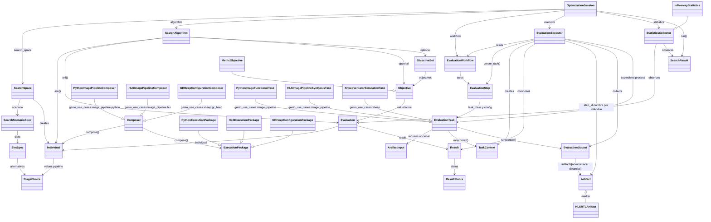

# Informe preliminar de arquitectura de GENIO

## Objetivo Del Framework

GENIO es un framework de optimizacion extensible. Su nucleo `src/genio` contiene algoritmos de busqueda, `SearchSpace`, las bases `Composer`/`ExecutionPackage` y `Artifact`, `EvaluationStep`/`EvaluationTask`/`EvaluationWorkflow`/`EvaluationExecutor`, objetivos, estadisticas y sesiones. Las implementaciones de dominio se distribuyen en el paquete instalable `src/genio_use_cases`; los escenarios JSON y runners bajo `use_cases/` son experimentos del repositorio, no modulos de la distribucion instalada.

```text
src/
├── genio/                         # contratos, busqueda, evaluacion, objetivos y sesion
└── genio_use_cases/               # extensiones instalables, solo codigo
    ├── image_pipeline/            # composers Python/HLS, tasks, RTL, informes HLS
    └── xheep/                     # composer GR-HEEP y simulacion Verilator
search_space/stages/                # definitions e implementations del checkout
hls_templates/vitis_vision_image_pipeline/  # plantillas HLS del checkout
hls_implementations/include/        # headers propios del checkout
gr_heep_templates/                 # plantillas GR-HEEP del checkout
use_cases/                          # escenarios y runners del checkout, no instalados
├── insect_segmentation/
└── date_experiments/
```

`genio_use_cases.image_pipeline.python` contiene `PythonImagePipelineComposer` y `PythonExecutionPackage`; `.hls` contiene `HLSImagePipelineComposer` y `HLSExecutionPackage`; `.image_functional` y `.hls_image_pipeline_synthesis` contienen las tasks respectivas, `.hls_synthesis` contiene `HLSRTLArtifact` y `.hls_reports` los parsers de informes. `genio_use_cases.xheep.gr_heep` contiene `GRHeepConfigurationComposer`/`GRHeepConfigurationPackage` y `.xheep_verilator_simulation` la task de simulacion. Las clases de dominio tambien se exportan desde `genio_use_cases.image_pipeline` y `genio_use_cases.xheep`, no desde `genio`.

Para dependencias de dominio, instalar `pip install -e '.[image_pipeline]'` o `pip install -e '.[image_pipeline,xheep]'`; Vitis, GR-HEEP y Conda siguen siendo requisitos externos. El paquete instalado solo contiene codigo: el llamador debe proporcionar las rutas de `search_space/stages`, `hls_templates`, `hls_implementations` y `gr_heep_templates` desde un checkout. Los ejemplos de `use_cases/` se ejecutan desde la raiz del repositorio con `python -m use_cases.insect_segmentation.run_random_search`, `python -m use_cases.insect_segmentation.run_population_search`, `python -m use_cases.insect_segmentation.run_genetic_search` o `python -m use_cases.date_experiments.run`.

El framework separa estas responsabilidades:

- Definir el dominio de busqueda.
- Representar individuos, artefactos, evaluaciones y resultados.
- Proponer individuos mediante algoritmos de busqueda.
- Interpretar metricas mediante objetivos reutilizables.
- Declarar workflows de evaluacion con pasos dependientes.
- Convertir cada paso en una tarea ejecutable.
- Ejecutar tareas en procesos locales supervisados.
- Registrar estadisticas de la sesion.

La clase que conecta estas piezas es `OptimizationSession`.

```text
OptimizationSession
├── SearchSpace
├── SearchAlgorithm
├── ObjectiveSet opcional y ObjectiveRuntime privado
├── EvaluationWorkflow
│   └── EvaluationStep[]
│       └── EvaluationTask
├── EvaluationExecutor
├── Supervisor de procesos locales
└── StatisticsCollector
```

## Flujo Del Framework

```text
OptimizationSession.run()
        ↓
StatisticsCollector.on_session_started(session)
        ↓
SearchAlgorithm.configure(SearchContext)
        ↓
SearchAlgorithm.ask()
        ↓
Individual[]
        ↓
StatisticsCollector.on_batch_started(batch_index, individuals)
        ↓
OptimizationSession asigna Proposal[] con id, secuencia y posicion
        ↓
StatisticsCollector.on_proposals_generated(proposals)
        ↓
OptimizationSession.evaluate(individuals)
        ↓
EvaluationExecutor.evaluate_many(individuals)
        ↓
Para cada Individual:
        ↓
EvaluationWorkflow.execution_order()
        ↓
Para cada EvaluationStep:
        ↓
EvaluationStep.create_task(individual, required_artifacts)
        ↓
EvaluationTask concreta
        ↓
EvaluationExecutor valida isinstance(task, EvaluationTask)
        ↓
Supervisor prepara workspace por individuo/step e inicia proceso local con TaskContext(workspace, resources)
        ↓
EvaluationTask.run(context)
        ↓
EvaluationOutput(metrics, artifacts)
        ↓
Supervisor recoge EvaluationOutput y el estado del proceso
        ↓
EvaluationExecutor acumula artifacts internamente como step_id.artifact_name
        ↓
EvaluationExecutor agrega las metricas locales como step_id.metric_name
        ↓
Result.success(individual.id, metrics=accumulated_metrics)
        ↓
OptimizationSession crea Evaluation con metadata de Proposal
        ↓
ObjectiveRuntime.evaluate_batch(evaluations)
        ↓
EvaluatedBatch
        ↓
StatisticsCollector.on_evaluation_completed(evaluation)
        ↓
SearchAlgorithm.tell(evaluated_batch)
        ↓
SearchAlgorithm consume las vistas objetivo que necesita
        ↓
StatisticsCollector.on_evaluated_batch(evaluated_batch)
        ↓
StatisticsCollector.on_batch_completed(batch_index, evaluations)
        ↓
SearchAlgorithm.should_stop()
        ↓
SearchResult
        ↓
StatisticsCollector.on_session_completed(result)
```

## Reglas Arquitectonicas

- `EvaluationStep` configura una clase de task; la task declara sus entradas y salidas de artefactos.
- `EvaluationStep.create_task(...)` no ejecuta herramientas externas ni toca infraestructura.
- `EvaluationTask` contiene la receta concreta de ejecucion de una unidad de trabajo.
- `EvaluationTask.run(context)` puede crear carpetas, invocar composers, usar plantillas y ejecutar comandos; devuelve `EvaluationOutput` con metricas y artefactos separados.
- Las metricas de `EvaluationOutput.metrics` se agregan en `Result.metrics`; los artefactos solo alimentan steps posteriores.
- `Result.metrics` contiene datos numericos sin semantica de optimizacion.
- `Objective` selecciona metricas concretas y declara si se maximizan o minimizan.
- `ObjectiveSet` pertenece a la sesion y configura extraccion, normalizacion y scalarizacion.
- Cada algoritmo valida el `ObjectiveSchema` y consume el `EvaluatedBatch` que necesita.
- `OptimizationSession` supervisa procesos locales y recoge `EvaluationOutput` de cada task.
- `OptimizationSession` posee la `EvaluationCache` de su ejecucion; `EvaluationTask` declara dependencias de dominios y `EvaluationExecutor` calcula las claves y restaura las salidas.
- `TaskContext` expone el workspace preparado y los recursos de ejecucion, sin helpers ni logica de dominio.
- Configuraciones especificas como plantillas Vitis, rutas de dataset o comandos de toolchain deben vivir en la `EvaluationTask`, en artefactos de entrada o en objetos de configuracion propios. Los pesos de scoring pertenecen al `Scalarizer` de `ObjectiveSet`.
- `evaluation_workflow` es obligatorio en `OptimizationSession`; no existe evaluacion por defecto independiente del dominio.

## Clases Implementadas

## 1. Orquestacion De Sesion

### `OptimizationSession`

Ubicacion: `src/genio/session/optimization.py`

Coordina el ciclo completo de optimizacion.

Constructor:

```python
OptimizationSession(
    search_space: SearchSpace,
    algorithm: SearchAlgorithm,
    evaluation_workflow: EvaluationWorkflow,
    max_workers: int = 1,
    work_dir: Path | None = None,
    execution_metadata: Mapping[str, Any] | None = None,
    statistics: StatisticsCollector | None = None,
    id: str | None = None,
    run_id: str | None = None,
    metadata: dict[str, Any] | None = None,
    checkpoint_policy: CheckpointPolicy | None = None,
    objective_set: ObjectiveSet | None = None,
    keep_all_individuals: bool = False,
)
```

Interfaz:

```python
run() -> SearchResult
evaluate(individuals: Sequence[Individual]) -> list[Evaluation]
save_checkpoint() -> Path | None
```

Responsabilidades:

- Mantener referencias a `SearchSpace`, `SearchAlgorithm`, `EvaluationWorkflow`, `EvaluationExecutor` y `StatisticsCollector`.
- Ejecutar el ciclo `ask/evaluate/tell`.
- Delegar evaluaciones en `EvaluationExecutor`.
- Asignar identidad unica y orden global a cada propuesta generada.
- Convertir `Result` en `Evaluation` y anotar metadata de propuesta durante `run()`.
- Notificar eventos a `StatisticsCollector`.
- Guardar y restaurar checkpoints consistentes entre batches cuando existe una policy.
- Construir y devolver `SearchResult`.

Por defecto `OptimizationSession(keep_all_individuals=False)` elimina workspaces de
`work_dir/workspaces` al cerrar cada batch, despues de statistics/checkpoint y de
todos los steps downstream. `keep_all_individuals=True` los conserva para depuracion;
los logs se retienen independientemente bajo `work_dir/logs`.

### Checkpoints De Sesion

Ubicacion: `src/genio/checkpoint/`

El algoritmo declara como serializar su estado, pero `OptimizationSession` controla
el momento de persistencia. Los checkpoints automaticos se crean exclusivamente tras
completar `tell()` y `StatisticsCollector.on_batch_completed()`.

```python
session = OptimizationSession(
    ...,
    checkpoint_policy=CheckpointPolicy(
        directory=Path("tmp/checkpoints"),
        every_batches=1,
        keep_last=3,
        save_on_completion=True,
    ),
)
```

Para continuar una ejecucion:

```python
session = OptimizationSession(
    ...,
    run_id=None,
    checkpoint_policy=CheckpointPolicy(
        directory=Path("tmp/checkpoints"),
        resume_from=Path("tmp/checkpoints/latest.json"),
    ),
)
```

`latest.json` es un manifest que referencia un snapshot inmutable. Cada snapshot y
el manifest se escriben mediante `fsync` y reemplazo atomico, incluyen checksums y
se crean con permisos restrictivos. `keep_last` limita snapshots antiguos sin borrar
el snapshot publicado actualmente.

El payload contiene:

- Estado minimo del algoritmo, como su RNG o cursor nativo.
- Estado del asignador de IDs de `SearchSpace`.
- Evaluaciones y batches objetivos comprometidos, almacenados una sola vez por la sesion.
- Siguiente batch y siguiente secuencia de propuesta.
- Estado del collector de estadisticas.
- `session_id`, `run_id` y estado terminal o en ejecucion.

Antes de restaurar se validan fingerprints de:

- Configuracion y tipo del algoritmo.
- Estructura ordenada completa del search space.
- Workflow, steps, composers, definiciones y templates.
- Configuracion y metadata de ejecucion.
- Collector de estadisticas y metadata de sesion.
- `compatibility_tag` opcional proporcionado por el experimento.

`SearchAlgorithm`, `StatisticsCollector`, `EvaluationStep` y `Composer`
exponen metodos `checkpoint_signature()`. La firma del step incluye id, clase de
task, config, timeout y contratos de artefactos; el workflow firma la lista reordenada
de steps. Los
algoritmos implementados exponen ademas `checkpoint_state()` y
`restore_checkpoint_state(...)`.

El formato es unico y responsabilidad de `OptimizationSession`; no existen versiones
ni formatos por algoritmo. No se persisten batches en curso, handles, procesos ni conexiones.
Una interrupcion durante un batch restaura el ultimo batch completo y repite el
siguiente con los mismos IDs y estado RNG.
La `EvaluationCache` tampoco se guarda en checkpoints: se limpia tanto al iniciar una
sesion nueva como al reanudarla, por lo que la reanudacion vuelve a ejecutar los
steps hasta poblarla de nuevo.

## 2. Dominio De Busqueda

### `SearchSpace`

Ubicacion: `src/genio/search_space/space.py`

Define el dominio finito de busqueda y construye individuos validos.

Interfaz principal:

```python
SearchSpace(test_file, stages_definitions_path=None)
SearchSpace.from_scenario(scenario) -> SearchSpace
from_genotype(genotype, *, id=None, metadata=None) -> Individual
from_index(search_index, *, id=None, metadata=None) -> Individual
slot_gene_positions -> tuple[int, ...]
sample(...) -> Individual
sample_population(size, unique=True, ...) -> list[Individual]
genotype_to_index(genotype) -> int
index_to_genotype(search_index) -> tuple[int, ...]
to_genotype(individual) -> tuple[int, ...]
to_index(individual) -> int
```

Responsabilidades:

- Cargar escenarios desde JSON.
- Cargar definiciones de etapas cuando el escenario contiene un pipeline.
- Construir `SearchScenarioSpec` y `SlotSpec`.
- Expandir alternativas de parametros.
- Crear individuos desde genotipos, indices o slots.
- Convertir entre genotipo, indice e individuo.
- Muestrear individuos y poblaciones.
- Validar estructura basica del espacio.
- Evaluar restricciones declaradas en definiciones de stages para los escenarios con pipeline.

### `SearchScenarioSpec`

Ubicacion: `src/genio/search_space/spec.py`

Dataclass inmutable que describe un escenario de busqueda.

Campos:

```python
id: str
slots: tuple[SlotSpec, ...]
design_spaces: dict[str, dict[str, tuple[Any, ...]]]
metadata: dict[str, Any]
domain_order: tuple[str, ...]
```

En el JSON de entrada, `design_spaces.pipeline` puede contener slots ordenados; al cargarlo se almacena en `slots`. Para problemas sin pipeline, se omite esta clave y `slots` queda vacío. `SearchScenarioSpec.design_spaces` contiene los dominios de parámetros discretos, independientemente del problema; al menos una dimensión debe estar presente. `domain_order` conserva el orden de aparición de los dominios, incluido `pipeline`, para ubicar sus genes. En los escenarios HLS, `hls` es consumido por `HLSImagePipelineSynthesisTask` y `system` por `GRHeepConfigurationComposer` y `XHeepVerilatorSimulationTask`.

### `SlotSpec`

Ubicacion: `src/genio/search_space/spec.py`

Dataclass inmutable que describe las alternativas posibles en un slot.

Campos:

```python
index: int
alternatives: tuple[StageChoice, ...]
```

## 3. Modelo Core

### `StageChoice`

Ubicacion: `src/genio/core/individual.py`

Representa una eleccion concreta de etapa para un slot.

Campos:

```python
slot: int
stage: str
parameters: dict[str, Any]
wrapper_inputs: dict[str, Any]
```

### `Individual`

Ubicacion: `src/genio/core/individual.py`

Representa una solucion concreta dentro del espacio de busqueda.

Campos:

```python
id: str
scenario: str
values: dict[str, Any]
genotype: tuple[int, ...] | None
search_index: int | None
metadata: dict[str, Any]
```

`values` reúne las elecciones materializadas por dominio; `pipeline` contiene una tupla de `StageChoice` cuando existe:

```python
{
    "pipeline": (StageChoice(slot=0, stage="resize"),),
    "hls": {
        "pipeline_ii": 1,
    },
    "system": {
        "memory_total_kib": 256,
        "memory_bank_size_kib": 32,
        "memory_interleaved_ratio": 50,
    },
}
```

El genotype representa la combinación completa de genes de pipeline y genes de diseño en el orden declarado en `design_spaces`. Los steps deben consumir solo el dominio que les corresponde.

Creación e interfaz:

```python
SearchSpace.from_genotype(...) -> Individual
```

### `Proposal`

Ubicacion: `src/genio/core/proposal.py`

Representa una aparicion concreta de un individuo generada por `SearchAlgorithm.ask()`.

Campos:

```python
proposal_id: str
proposal_sequence: int
batch_index: int | None
batch_position: int
individual: Individual
```

La identidad de propuesta pertenece a la ejecucion de busqueda y no modifica el diseño contenido en `Individual`.

### `Artifact`

Ubicacion: `src/genio/evaluation/artifact.py`

`Artifact[T]` es una dataclass concreta, generica, frozen y slotted para salidas
producidas por evaluaciones y consumidas por pasos posteriores.

Campos:

```python
data: T | None = None
files: Mapping[str, Path] = field(default_factory=dict)
```

Responsabilidades:

- Transportar datos estructurados pequenos y serializables con `pickle` en `data`.
- Asociar nombres logicos en `files` a rutas de archivos existentes dentro del
  workspace de la task productora.
- Servir como frontera entre steps.

Las metricas numericas no requieren una subclase de `Artifact`: la task las devuelve en
`EvaluationOutput.metrics`. No hay metodo `load()` ni campos de identidad `name`,
`producer`, `individual_id`, `objective` o `metadata`: el nombre local lo asigna
`EvaluationOutput.artifacts` y el executor lo cualifica con `step_id.` dentro
de la acumulacion independiente de cada individuo.
La interpretacion de objetivos pertenece a `ObjectiveSet`.

`HLSRTLArtifact` es una subclase marcador de `Artifact[Mapping[str, Any]]`:
se define en `genio_use_cases.image_pipeline.hls_synthesis` (no en el nucleo);
`data` incluye `origin`, `top_function`, `interface` y metadatos de imagen;
`files` referencia el RTL mediante claves `verilog/<path>` o `vhdl/<path>`.
El step X-HEEP consume ambas partes para integrar el acelerador.

### `Result` y `ResultStatus`

Ubicacion: `src/genio/core/result.py`

`Result` representa la salida normalizada de la evaluacion completa de un individuo.

Campos:

```python
individual_id: str
status: ResultStatus
metrics: dict[str, float]
error: str | None
metadata: dict[str, object]
```

Metodos:

```python
Result.success(individual_id, metrics=None)
Result.failed(individual_id, error, metrics=None)
```

`ResultStatus` define:

```python
SUCCESS = "success"
FAILED = "failed"
```

### `Evaluation`

Ubicacion: `src/genio/core/evaluation.py`

Conecta un individuo con su resultado.

Campos:

```python
individual: Individual
result: Result
metadata: dict[str, Any]
```

### `SearchResult`

Ubicacion: `src/genio/core/search_result.py`

Resultado final de una sesion.

Campos:

```python
session_id: str
run_id: str | None
evaluations: tuple[Evaluation, ...]
best_individuals: tuple[Individual, ...]
statistics: dict[str, Any]
```

## 4. Estrategia De Busqueda

### `SearchAlgorithm`

Ubicacion: `src/genio/algorithm/base.py`

Contrato abstracto para algoritmos de busqueda mediante el patron `ask/tell`.

Interfaz:

```python
configure(context: SearchContext) -> None
ask() -> Sequence[Individual]
tell(batch: EvaluatedBatch) -> None
should_stop() -> bool
best_individuals() -> Sequence[Individual]
```

Responsabilidades:

- Proponer individuos.
- Recibir evaluaciones y objetivos ya interpretados en `EvaluatedBatch`.
- Mantener estado interno de busqueda.
- Decidir cuando detenerse.
- Exponer mejores individuos.

### `GeneticSearch`

Ubicacion: `src/genio/algorithm/genetic.py`

Adaptacion generacional del explorador genetico heredado al contrato `ask/tell`.
Una llamada a `ask()` produce una poblacion completa y `tell()` exige exactamente
las evaluaciones de esa poblacion antes de permitir la siguiente generacion.

Constructor:

```python
GeneticSearch(
    population_size: int = 80,
    mutation_probability: float = 0.05,
    max_generations: int = 20,
    start_generation: int = 1,
    balanced_initialization: bool = True,
    initial_population: Sequence[Sequence[int]] | None = None,
    random: Random | None = None,
)
```

`GeneticSearch` requiere que la sesion configure un `Scalarizer`. Para mas de una
generacion, el score debe ser comparable: sin normalizacion o con normalizacion
`FIXED`. Los objetivos, bounds y pesos se configuran en `ObjectiveSet`.

Proceso por generacion:

1. Recibir el score agregado calculado por `ObjectiveRuntime`.
2. Asignar fitness cero a evaluaciones fallidas.
3. Descartar de la ruleta fitness inferiores a la mediana de la poblacion.
4. Seleccionar el primer padre por ruleta y el segundo media vuelta despues.
5. Generar hermanos complementarios mediante crossover uniforme por gen.
6. Aplicar a cada hijo una sustitucion de un unico gen con la probabilidad configurada.
7. Reemplazar por completo la poblacion anterior, sin elitismo.

La inicializacion y la mutacion de genes de pipeline usan muestreo balanceado por
tipo de stage. Los parametros de design forman parte del mismo genotipo y se cruzan
y mutan de forma uniforme. Se permiten genotipos duplicados, pero cada propuesta se
materializa como un `Individual` nuevo con ID y metadata de generacion propios.

Los pesos se identifican por `Objective.name` y se validan en `WeightedMeanScalarizer`.
Un objetivo constante normalizado aporta cero porque no permite discriminar candidatos.
Si todos los fitness retenidos son cero, los padres se seleccionan
uniformemente entre evaluaciones exitosas. Si falla toda la generacion, la siguiente
poblacion se reinicializa de forma aleatoria.

`max_generations` es el numero de la ultima generacion. Para continuar desde una
generacion previa se proporcionan `start_generation` e `initial_population`; por
ejemplo, `start_generation=10, max_generations=20` evalua las generaciones 10 a 20.

Metadata generada por individuo:

```python
{
    "algorithm": {
        "generation": 2,
        "population_index": 4,
        "proposal_origin": "crossover",
        "parent_ids": ["parent-a", "parent-b"],
        "mutation_applied": True,
        "mutation_changed": False,
    }
}
```

`best_individuals()` devuelve el mejor individuo global segun los scores comparables
recibidos. `generation_best_individuals()` conserva el mejor de cada
generacion y `generation_fitnesses()` expone los fitness usados para seleccion.

La adaptacion corrige defectos del codigo heredado: poblaciones impares, generacion
extra sin consumir, IDs obsoletos tras mutacion, crash cuando todos fallan, orden de
resultados dependiente de workers y ruleta degenerada cuando el fitness total es cero.

## 5. Objetivos De Optimizacion

### `OptimizationDirection`

Ubicacion: `src/genio/objective/base.py`

Enum que declara la direccion de mejora de un objetivo.

```python
MAXIMIZE = "maximize"
MINIMIZE = "minimize"
```

### `Objective` y `ObjectiveError`

Ubicacion: `src/genio/objective/base.py`

Contrato abstracto para interpretar un valor numerico desde una `Evaluation`.

Interfaz:

```python
name: str
direction: OptimizationDirection
value(evaluation: Evaluation) -> float
```

Responsabilidades:

- Seleccionar o calcular un valor objetivo desde `Result.metrics`.
- Declarar si el objetivo se maximiza o minimiza.
- Proporcionar un score escalar uniforme para algoritmos que lo necesiten.

No debe:

- Proponer individuos.
- Ejecutar evaluaciones.
- Modificar `Result.metrics`.

`ObjectiveError` se lanza cuando un objetivo no puede evaluarse, por ejemplo por metricas ausentes, valores no numericos, conjuntos vacios o nombres duplicados.

### `MetricObjective`

Ubicacion: `src/genio/objective/base.py`

Implementacion de `Objective` basada en una clave concreta de `Result.metrics`.

Constructor:

```python
MetricObjective(
    metric: str,
    direction: OptimizationDirection | str,
    *,
    name: str | None = None,
    normalization_bounds: tuple[float, float] | None = None,
)
```

Reglas:

- `metric` es la clave que se lee desde `evaluation.result.metrics`.
- `id` permite dar un nombre estable distinto de la clave de metrica.
- Si `name` no se proporciona, toma el valor de `metric`.
- Rechaza metricas ausentes, booleanos y valores no numericos.

Ejemplo:

```python
MetricObjective("functional.f1", OptimizationDirection.MAXIMIZE)
MetricObjective("hls.latency", OptimizationDirection.MINIMIZE, name="latency")
```

### `ObjectiveSet`

Ubicacion: `src/genio/objective/base.py`

Configura la extraccion ordenada de objetivos y las estrategias opcionales de
normalizacion y scalarizacion de una sesion.

Constructor:

```python
ObjectiveSet(
    objectives: Sequence[Objective],
    normalizer: Normalizer | None = None,
    scalarizer: Scalarizer | None = None,
)
```

Interfaz:

```python
schema: ObjectiveSchema
bind() -> ObjectiveRuntime
checkpoint_signature() -> Mapping[str, Any]
```

Reglas:

- Requiere al menos un objetivo.
- Rechaza nombres de objetivos duplicados.
- Preserva el orden de los objetivos para algoritmos que necesiten vectores.
- La extraccion se realiza exclusivamente a traves del runtime creado por la
  sesion; `ObjectiveSet` no interpreta evaluaciones directamente.

### Relacion Con Algoritmos

Los objetivos son opcionales para la sesion. Los algoritmos escalares o
multiobjetivo validan durante `configure()` que la sesion proporcione el esquema
que necesitan:

```python
GridSearch()
RandomSearch()
algorithm = NSGA2Search()
objective_set = ObjectiveSet((
    MetricObjective("quality.f1", OptimizationDirection.MAXIMIZE),
    MetricObjective("hls.latency", OptimizationDirection.MINIMIZE),
))
session = OptimizationSession(
    algorithm=algorithm,
    objective_set=objective_set,
    ...,
)
```

Separacion de responsabilidades:

- `Result.metrics` contiene datos numericos crudos.
- `Objective` interpreta metricas y direccion.
- `SearchAlgorithm` usa objetivos solo si su estrategia lo requiere.

## 6. Workflow De Evaluacion

### `EvaluationWorkflow`

Ubicacion: `src/genio/evaluation/workflow.py`

Dataclass inmutable que representa pasos de evaluacion con dependencias inferidas de sus artefactos requeridos.

Campos:

```python
steps: tuple[EvaluationStep, ...]
```

Interfaz:

```python
execution_order() -> tuple[EvaluationStep, ...]
checkpoint_signature() -> list[Mapping[str, object]]
```

Responsabilidades:

- Guardar pasos de evaluacion.
- Validar ids duplicados.
- Priorizar el orden declarado entre steps listos y adelantar productores requeridos.
- Inferir cada productor solo por el id de step en `step_id.artifact_name` y comprobar que existe ese step.
- Validar la forma y el tipo declarado de cada requisito, no las salidas dinamicas del productor.
- Rechazar dependencias circulares entre artefactos.

### `EvaluationWorkflowError`

Ubicacion: `src/genio/evaluation/workflow.py`

Excepcion base para workflows invalidos.

Casos:

- ids duplicados;
- artefactos requeridos cuyo id de step productor no existe;
- dependencias circulares;
- requisitos y tipos de artefactos invalidos.

### `EvaluationStep`

Ubicacion: `src/genio/evaluation/step.py`

Dataclass generica que configura un paso logico del workflow.

Interfaz:

```python
@dataclass(frozen=True, slots=True)
class EvaluationStep:
    id: str
    task_class: type[EvaluationTask]
    config: Mapping[str, Any] = field(default_factory=dict)
    timeout_seconds: float | None = None
```

Responsabilidades:

- Declarar un identificador de paso.
- Derivar entradas de `task_class.requires`; las salidas se nombran al devolver `EvaluationOutput.artifacts`.
- Pasar `config` al constructor tipado de la task junto con `individual`, `step_id`
  y el mapa de artefactos requeridos, inyectados por el framework.

Restriccion:

- `config` no puede sobrescribir `individual`, `step_id` ni `artifacts`.
- El workflow comprueba antes de ejecutar que existe otro step con el id productor
  y lo ordena antes del consumidor; la presencia y el tipo del artefacto se comprueban en ejecucion.

### `EvaluationExecutor` y `EvaluationExecutionError`

Ubicacion: `src/genio/evaluation/executor.py`

Ejecuta un `EvaluationWorkflow` para uno o varios individuos en procesos locales supervisados.

Interfaz:

```python
evaluate(individual: Individual) -> Result
evaluate_many(individuals: Sequence[Individual]) -> list[Result]
```

Responsabilidades:

- Recorrer `EvaluationWorkflow.execution_order()`.
- Crear tasks mediante `EvaluationStep.create_task(...)` con solo los artefactos requeridos.
- Validar que la instancia creada es una `EvaluationTask`.
- Validar que la task pertenece al individuo y step solicitados.
- Ejecutar tasks en procesos locales supervisados.
- Recoger `EvaluationOutput` de los procesos.
- Acumular artefactos internamente con claves `step_id.artifact_name` para alimentar steps dependientes.
- Agregar las metricas locales de `EvaluationOutput.metrics` con claves `step_id.metric_name`.
- Componer un `Result.success(...)` por individuo con `metrics`, sin incluir artefactos en el `Result`.
- Rechazar claves duplicadas de artefactos o metricas.
- Rechazar nombres de artifacts invalidos, tipos incorrectos y referencias a
  archivos inexistentes o fuera del workspace de la task productora.
- Rechazar metricas no numericas.

`EvaluationExecutionError` se lanza cuando una task devuelve una salida que no es `EvaluationOutput`, produce artefactos invalidos, duplica claves de artefactos o metricas, devuelve metricas no numericas, o cuando un productor exitoso omite un artefacto requerido o devuelve uno de tipo incorrecto. Estos errores de contrato abortan toda la sesion de optimizacion; los fallos de ejecucion de una task productora siguen siendo individuales y no detienen el resto del batch.

### Cache De Evaluaciones Por Step

`EvaluationCache` es local a una `OptimizationSession` y separa las entradas por
step. `cache_capacity` asigna a cada ID un maximo de entradas: un step omitido o
con `0` no usa cache, un entero positivo aplica LRU y `None` no limita su numero.
Se elimina al terminar `run()` y no forma parte de checkpoints. Solo se reutilizan
salidas exitosas; en una misma ola del step,
evaluaciones equivalentes se coalescen para ejecutar una task representante y
repartir su salida a los individuos correspondientes.

Una clase `EvaluationTask` puede declarar `uses_domains` como tupla de nombres de
dominios de `Individual.values`. Si no lo declara, se consideran todos los
dominios. Las tasks integradas declaran `PythonImageFunctionalTask`:
`("pipeline",)`, `HLSImagePipelineSynthesisTask`: `("pipeline", "hls")` y
`XHeepVerilatorSimulationTask`: `("system",)`. El executor agrega de manera
transitiva los dominios de los steps productores de cada artefacto requerido: la
simulacion X-HEEP tambien depende del pipeline y de HLS por su RTL de entrada.

La reutilizacion presupone que la task es determinista para sus dominios declarados
y que datasets, toolchains, plantillas y otros recursos externos permanecen
inmutables durante la sesion. La cache copia los archivos de `Artifact.files` fuera
del workspace productor y, en cada hit o resultado coalescido, restaura copias en
el workspace propio de cada individuo; nunca comparte rutas del productor. No es
un almacen persistente de artefactos ni sustituye `keep_all_individuals`.

## 7. Tareas Ejecutables

### `TaskContext`

Ubicacion: `src/genio/evaluation/task.py`

Contexto de runtime local creado por el supervisor y entregado a cada task.

Campos (dataclass inmutable):

```python
workspace: Path
resources: Mapping[str, Any] = field(default_factory=dict)
```

Responsabilidades:

- Exponer `workspace`, ya creado por el executor para un individuo y un step.
- Transportar `execution_metadata` de la sesion mediante `resources`; la configuracion propia de la task permanece en `EvaluationTask.metadata`.
- Mantener las tasks desacopladas del supervisor de procesos.

No existen helpers de rutas, filesystem, logs ni comandos en `TaskContext`. Las
tasks usan `pathlib`, `json`, `shutil` y `subprocess` directamente; si necesitan
preservar symlinks al copiar un checkout, configuran `shutil.copytree` ellas mismas.
Los archivos referenciados por `Artifact.files` deben existir dentro del
`workspace` de la task productora al devolver la salida.

Regla:

- `TaskContext` no debe convertirse en configuracion de dominio.
- Informacion especifica como plantillas Vitis, datasets, toolchains o pesos de scoring debe vivir en tasks concretas, artefactos o configs propias.

### `EvaluationOutput` y `EvaluationTask`

Ubicacion: `src/genio/evaluation/task.py`

`EvaluationOutput` es una dataclass inmutable que separa las metricas locales de los
artefactos persistentes producidos por una task:

```python
metrics: Mapping[str, float] = field(default_factory=dict)
artifacts: Mapping[str, Artifact] = field(default_factory=dict)
```

Cada clase de task puede declarar sus entradas como atributo de clase:

```python
requires: ClassVar[tuple[ArtifactInput, ...]] = (
    ArtifactInput("hls_image_pipeline_synthesis.rtl_hls_synthesis", HLSRTLArtifact),
)
```

`ArtifactInput(source, artifact_type)` identifica una clave cualificada y el
tipo requerido. El step deriva `required_artifacts` y entrega solo el mapa requerido al campo
`EvaluationTask.artifacts` al construir la task.

Los nombres de metricas son locales al step (pueden contener puntos); el executor
antepone `step_id.`. Las claves de `EvaluationOutput.artifacts` son nombres locales
no vacios y sin puntos, elegidos dinamicamente por `run`; el executor los acumula internamente como `step_id.nombre`
por individuo para los pasos siguientes. Por ejemplo, HLS devuelve metricas y un
`HLSRTLArtifact` bajo `rtl_hls_synthesis`, mientras que las tasks funcional y
X-HEEP devuelven solo metricas.

Clase abstracta que representa una unidad ejecutable de evaluacion.

Campos:

```python
individual: Individual
id: str | None
step_id: str | None
artifacts: Mapping[str, Artifact]
metadata: Mapping[str, Any]
runtime_state: dict[str, Any]
```

Propiedad:

```python
task_id: str
```

Configuracion de ejecucion opcional:

```python
timeout_seconds=1800
```

`EvaluationStep.timeout_seconds` es opcional (`None` por defecto). El supervisor
aplica el limite al proceso de la task, no solo a un comando `v++`.

Metodo abstracto:

```python
run(context: TaskContext) -> EvaluationOutput
on_timeout(context: TaskContext) -> None  # opcional
```

Responsabilidades:

- Encapsular una unidad concreta de trabajo.
- Definir la receta real de ejecucion de un tipo de tarea.
- Decidir su organizacion interna de directorios dentro de `context.workspace`.
- Invocar composers, plantillas o herramientas externas cuando su dominio lo requiera.
- Devolver metricas y artefactos producidos en `EvaluationOutput`.
- Limpiar recursos externos en `on_timeout` solo cuando sea necesario; el estado
  mutable compartido con `run` existe exclusivamente dentro del worker.

## 8. Infraestructura De Ejecucion

### Supervisor De Procesos Locales

`OptimizationSession` configura el executor, que inicia las tasks en procesos locales supervisados para
cualquier valor de `max_workers`, incluido 1. No hay backends ni handles publicos.
Los fallos de una task se convierten en `Result.failed` solo para su individuo;
este no avanza a steps posteriores mientras el resto del batch continua.

`work_dir/workspaces/<individual>/<step>` contiene el workspace preparado de cada task. Los logs se escriben
aparte bajo `work_dir/logs/<run_id>/<individual>/<step>` y se conservan aunque se
elimine el workspace al cerrar el batch. El supervisor captura stdout/stderr del
proceso Python en `stdout.log` y `stderr.log`; los subprocesos creados con
`subprocess` heredan esas salidas y el grupo supervisado salvo que la task las
capture deliberadamente. Las tasks integradas escriben sus propios archivos en
`workspace/logs`, que se copian a `work_dir/logs/<run_id>/<individual>/<step>/task`
antes de la limpieza del batch (si no se conserva el workspace).
El timeout opcional de cada step limita la task completa. El supervisor envia
`SIGTERM` al worker para que la clase base pueda ejecutar `on_timeout` y espera
hasta tres segundos; despues termina el grupo completo con `SIGKILL` si sigue
activo. El resultado de timeout se registra en la sesion incluso si el worker no
alcanza a ejecutar el hook.

Los recursos requeridos por implementaciones concretas se proporcionan mediante
`execution_metadata` en la sesion. Por ejemplo:

```python
from pathlib import Path

# Ejecutar desde la raiz del checkout; en otro directorio, indicar su ruta absoluta.
repo_root = Path.cwd().resolve()

OptimizationSession(
    ...,
    max_workers=2,
    work_dir=Path("tmp/work"),
    execution_metadata={
        "vitis_libraries_path": "/path/to/Vitis_Libraries",
        "hls_include_paths": [
            str(repo_root / "hls_implementations/include"),
        ],
    },
)
```

La task HLS deriva `vision/L1/include` desde `vitis_libraries_path` y añade después
los directorios opcionales de `hls_include_paths`. Estos últimos permiten resolver
headers propios como `genio/identity.hpp` del checkout.
Otras tasks pueden
declarar y consumir sus propias rutas sin modificar la interfaz de la sesion.

`v++` se obtiene de `PATH`; la sesión debe iniciarse después de cargar mediante
`source` el entorno Vitis deseado. Las diferencias de API de Vitis Libraries se
declaran como variantes `versions` dentro del JSON de implementación. El composer
recibe `vitis_version` y genera directamente la llamada que corresponde al header
original del checkout activo, sin reimplementar funciones de Vitis Vision.

`use_cases/insect_segmentation/run_random_search.py` detecta la versión desde `XILINX_VITIS`, admite
el override `GENIO_VITIS_VERSION` y acepta `VITIS_LIBRARIES_PATH` para seleccionar
el checkout de librerías que corresponde al entorno activo.

El workflow puede continuar con `EvaluationStep(task_class=XHeepVerilatorSimulationTask)`, que consume
el RTL `safa_fifo`, compone un overlay GR-HEEP aislado y ejecuta X-HEEP/Verilator en el
entorno Conda `core-v-mini-mcu`. Esta task conserva los symlinks del checkout base,
inyecta una imagen real o sintética, genera tráfico con un segundo DMA y extrae las
etiquetas `GENIO_PERF`, `GENIO_METRIC` y `GENIO_STATUS`. La guía de uso completa está
en [Evaluación de pipelines HLS en X-HEEP con SAFA](XHEEP_SAFA_EVALUATION.md).

`EvaluationExecutor.evaluate_many` envia una ola por step del workflow. Los fallos de una task se convierten en `Result.failed` solo para su individual; ese individual no avanza a steps posteriores y el resto del batch continua. Los errores de contrato del framework siguen propagandose como excepciones.

El soporte SSH ha sido eliminado. Las tasks y los comandos se ejecutan solo en el
host local; `execution_metadata` debe contener rutas accesibles en ese host.

## 9. Composicion

### `Composer`, `ExecutionPackage`, `ComposerError` y `StageDefinitionNotFoundError`

Ubicacion: `src/genio/composer.py`

`Composer` es una clase abstracta para traducir un `Individual` a configuraciones, codigo, especificaciones o artefactos intermedios especificos de un dominio.
`ExecutionPackage` es su base generica para paquetes materializables; las variantes
`PythonExecutionPackage`, `HLSExecutionPackage` y `GRHeepConfigurationPackage`
viven en `genio_use_cases`, junto a sus composers.

Interfaz:

```python
compose(individual: Individual) -> Any
active_choices(individual)
active_stage_definitions(individual)
should_skip(choice)
stage_definition(stage)
artifact_metadata(individual)
```

Responsabilidades:

- Recorrer etapas activas de un individuo.
- Cargar y consultar definiciones de stages.
- Proporcionar utilidades comunes para compositores concretos.
- Generar informacion que una `EvaluationTask` concreta puede usar durante `run(context)`.

Regla:

- Si un composer necesita plantillas, filesystem o materializacion, debe ejecutarse dentro de una `EvaluationTask.run(context)` o en una task especifica de composicion.
- El supervisor de procesos no debe conocer composers concretos.

`ComposerError` es la excepcion base del subsistema de composicion.

`StageDefinitionNotFoundError` se lanza cuando un individuo referencia una etapa desconocida.

## 10. Estadisticas

### `StatisticsCollector`

Ubicacion: `src/genio/statistics/base.py`

Clase base extensible para recolectores de estadisticas.

Interfaz:

```python
on_session_started(session: OptimizationSession) -> None
on_batch_started(batch_index: int, individuals: Sequence[Individual]) -> None
on_proposals_generated(proposals: Sequence[Proposal]) -> None
on_evaluation_completed(evaluation: Evaluation) -> None
on_evaluated_batch(batch: EvaluatedBatch) -> None
on_batch_completed(batch_index: int, evaluations: Sequence[Evaluation]) -> None
on_session_completed(result: SearchResult) -> None
snapshot() -> dict[str, Any]
```

Los hooks de batch permiten registrar poblaciones completas. El framework usa el termino `batch` porque no todos los algoritmos son generacionales y un batch no debe interpretarse automaticamente como generacion.

Cada `Proposal` identifica una aparicion concreta de un individuo mediante `proposal_id`, `proposal_sequence`, `batch_index` y `batch_position`. Esto permite distinguir genotipos repetidos, reevaluaciones y propuestas producidas por algoritmos evolutivos.

### `InMemoryStatistics`

Ubicacion: `src/genio/statistics/base.py`

Implementacion simple de `StatisticsCollector`.

Snapshot actual:

```python
{"evaluations": len(self.evaluations), "batches": len(self.batches)}
```

### `CSVStatisticsCollector`

Ubicacion: `src/genio/statistics/csv.py`

Escribe una fila por propuesta en `individuals.csv`. Las filas se registran inicialmente como `not_evaluated` y se completan con estado, metricas y errores al terminar la evaluacion.

Tambien genera:

```text
run_manifest.json
run_summary.json
```

El CSV contiene representaciones JSON canonicas de genotype, pipeline, design y metadata, ademas de columnas promovidas para slots, dominios de diseño, metadata algorítmica y metricas.

### `CompositeStatisticsCollector`

Ubicacion: `src/genio/statistics/composite.py`

Agrupa una secuencia no vacia de collectors y propaga cada hook en orden estable. Sus
snapshots se almacenan en entradas independientes para evitar colisiones de nombres.
Solo soporta checkpoint cuando todos los collectors hijos lo soportan y restaura sus
estados en el mismo orden declarado.

```python
statistics = CompositeStatisticsCollector((
    CSVStatisticsCollector("results"),
    InMemoryStatistics(),
))
```

### `PopulationStatisticsCollector`

Ubicacion: `src/genio/statistics/population_statistics.py`

Fachada recomendada para generar en una sola configuracion el CSV, manifest y summary
del run junto con el analisis y plots poblacionales. Internamente compone
`CSVStatisticsCollector(output_dir)` y
`PopulationAnalysisCollector(output_dir / "analysis")`; su snapshot separa las claves
`csv` y `analysis` y permite acceder directamente a ambos collectors hijos.

### `PopulationRecord` y `PopulationSnapshot`

Ubicacion: `src/genio/statistics/population_models.py`

Modelos inmutables para collectors poblacionales. Un record se crea desde una
`Proposal` y se completa desde el `EvaluatedIndividual` con el mismo `proposal_id`.
El snapshot agrupa una poblacion cerrada, ordenada por `batch_position`, sin imponer
que todos los algoritmos interpreten un batch como generacion.

### `PopulationAnalysisCollector`

Ubicacion: `src/genio/statistics/population.py`

Captura propuestas, resultados objetivos y cierres de batch para construir snapshots
inmutables. La correlacion usa `proposal_id`, por lo que preserva ocurrencias repetidas.
Al completar la sesion guarda los IDs seleccionados por el algoritmo y genera
`analysis_summary.json`, `analysis_manifest.json` y `plots/final`. Una cadencia
`every_batches` opcional genera tambien directorios `plots/batch_*`. El checkpoint
persiste solo indices de batches y best IDs; records/snapshots se reconstruyen desde el
historico de sesion y los archivos de salida se regeneran, sin serializar figuras.

### Analisis Poblacional Puro

Ubicacion: `src/genio/statistics/population_analysis.py`

Proporciona funciones deterministas sobre snapshots para composicion, diversidad,
convergencia, proyeccion y comparacion de individuos seleccionados. La diversidad usa
entropia y distancia Hamming normalizada; la proyeccion usa PCA sobre codificacion
one-hot de genes categoricos. `NumericSummary` representa count, extremos, media,
mediana y cuartiles sin depender de Matplotlib ni del collector.

### `PopulationPlotRenderer`

Ubicacion: `src/genio/statistics/population_plots.py`

Renderer headless usado automaticamente por `PopulationAnalysisCollector` y disponible
tambien para uso directo. `PopulationPlotConfig` controla genes seguidos, formato
PNG/SVG, plots finales, cadencia intermedia y politica strict.
`PopulationPlotResult` separa archivos generados, graficos omitidos por falta de datos
y warnings recuperables. El modulo importa Matplotlib de forma diferida y no forma
parte del lifecycle del collector hasta la siguiente fase.

## Diagrama De Relaciones

```text
OptimizationSession
├── search_space: SearchSpace
├── algorithm: SearchAlgorithm
├── objective_set: ObjectiveSet opcional, propiedad de la sesion
├── max_workers, work_dir, execution_metadata
├── evaluation_workflow: EvaluationWorkflow
│   └── steps: tuple[EvaluationStep, ...]
├── evaluation_executor: EvaluationExecutor
│   ├── workflow: EvaluationWorkflow
│   └── procesos locales supervisados
└── statistics: StatisticsCollector
```

## Diagrama Mermaid



## Ejemplo Ejecutable

El siguiente ejemplo usa solo clases implementadas y reproduce el flujo basico cubierto por los tests.

```python
from genio import (
    Evaluation,
    EvaluationStep,
    EvaluationTask,
    EvaluationOutput,
    EvaluationWorkflow,
    TaskContext,
    Individual,
    OptimizationSession,
    SearchAlgorithm,
    SearchScenarioSpec,
    SearchSpace,
    SlotSpec,
    StageChoice,
)

class ScoreTask(EvaluationTask):
    def run(self, context: TaskContext) -> EvaluationOutput:
        score = self.individual.search_index or 0
        return EvaluationOutput(metrics={"score": float(score)})

class FirstIndividualAlgorithm(SearchAlgorithm):
    def __init__(self) -> None:
        self._evaluations: list[Evaluation] = []

    def ask(self):
        return [self.context.search_space.from_index(0, id="individual_001")]

    def tell(self, batch):
        self._evaluations.extend(batch.evaluations)

    def should_stop(self) -> bool:
        return bool(self._evaluations)

    def best_individuals(self):
        if not self._evaluations:
            return ()
        return [self._evaluations[0].individual]

search_space = SearchSpace.from_scenario(
    SearchScenarioSpec(
        id="one_slot_space",
        slots=(
            SlotSpec(
                index=0,
                alternatives=(StageChoice(slot=0, stage="threshold"),),
            ),
        ),
    )
)

session = OptimizationSession(
    id="example_session",
    search_space=search_space,
    algorithm=FirstIndividualAlgorithm(),
    max_workers=1,
    evaluation_workflow=EvaluationWorkflow((
        EvaluationStep(id="score", task_class=ScoreTask, config={}),
    )),
)

result = session.run()
score = result.evaluations[0].result.metrics["score.score"]
```

## Ejemplo De `EvaluationOutput`

Las metricas se declaran independientemente de los artefactos. Una task crea sus
archivos antes de devolver las salidas que necesita un step posterior:

```python
import json
from dataclasses import dataclass
from genio import Artifact, EvaluationOutput, EvaluationTask, TaskContext

@dataclass(frozen=True, slots=True)
class ReportTask(EvaluationTask):
    def run(self, context: TaskContext) -> EvaluationOutput:
        path = context.workspace / "report.json"
        path.write_text(json.dumps({"f1": 0.9}), encoding="utf-8")
        return EvaluationOutput(
            metrics={"f1": 0.9, "latency": 12.0},
            artifacts={"report": Artifact(
                data={"format": "json"}, files={"report": path}
            )},
        )

# EvaluationStep(id="score", task_class=ReportTask, config={}) ejecuta la task.
# El executor agrega "score.f1" y "score.latency" a Result.metrics.
# El artefacto queda disponible como "score.report" para otros steps.
```

Con la limpieza por defecto, el contenido de `files` deja de estar disponible tras
el batch; usar `keep_all_individuals=True` o copiarlo fuera del workspace para
conservarlo.

## Ejemplo De Uso De `TaskContext`

El supervisor crea `context.workspace` antes de ejecutar la task. La task usa
`pathlib`, `json` y `subprocess` directamente; el comando usa el interprete de
Python para mantenerlo portable.

```python
import json
import subprocess
import sys
from genio import EvaluationOutput, TaskContext, EvaluationTask

class ExampleTask(EvaluationTask):
    def run(self, context: TaskContext) -> EvaluationOutput:
        config_path = context.workspace / "config.json"
        config_path.write_text(json.dumps({"ok": True}, indent=2), encoding="utf-8")
        log_dir = context.workspace / "logs"
        log_dir.mkdir(exist_ok=True)
        (log_dir / "task.log").write_text("started\n", encoding="utf-8")
        subprocess.run(
            [sys.executable, "-c", "print('hello')"],
            cwd=context.workspace,
            check=True,
        )
        return EvaluationOutput()
```

El stdout del comando llega al log supervisado; para analizarlo en Python se puede
usar `subprocess.run(..., capture_output=True, text=True)` y escribirlo en
`workspace/logs` si se quiere conservar. El timeout del step sigue cubriendo
toda la ejecucion de la task.

## Clases Eliminadas En El Refactor

### `Candidate`

Fue eliminado para evitar duplicidad con `Individual`.

### `Evaluator`

Fue reemplazado primero por una fachada intermedia y posteriormente eliminado. La ruta principal de sesion usa `EvaluationExecutor`.

### `Runner`

Fue eliminado como abstraccion publica.

Modelo actual:

```text
OptimizationSession -> proceso local -> EvaluationTask.run(TaskContext) -> EvaluationOutput
```

### `SearchEngine`

Fue eliminado para evitar una segunda ruta de evaluacion paralela a `EvaluationExecutor`.

### `CallableEvaluationTask`

Fue eliminado porque era un adaptador de compatibilidad basado en callables. Las evaluaciones deben definirse mediante subclases concretas de `EvaluationTask`.

### `DefaultEvaluationStep`

Fue eliminado porque no existe una evaluacion por defecto independiente del dominio. Cada sesion debe proporcionar un `EvaluationWorkflow` explicito.

## Puntos Pendientes

- Definir objetivos/fitness sobre las claves disponibles en `Result.metrics`.
- Definir politica de errores: convertir fallos de tasks en `Result.failed` o propagar excepciones.
- Separar implementaciones concretas de algoritmos en modulos como `algorithm/random.py`, `algorithm/grid.py` o adaptadores externos.
- Enriquecer `StatisticsCollector` con tiempos, historico de metricas, mejores individuos y errores.
- Definir persistencia de tasks, artefactos, resultados y sesiones.
